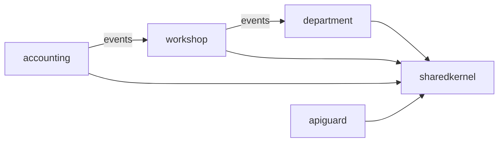

# Instrument Repair: The Essence of DDD in Code

Companion project for [The Essence of Domain-Driven Design][post].

The post explains its ideas with one sentence from a real company: *"I send a medical
instrument for repair."* This project turns that sentence into a small Java application
with three bounded contexts: the hospital **department**, the repair **workshop**, and
**accounting**.

Two promises:

* Every important class answers a sentence or a rule from the post.
* Every rule is checked by a tool, not by good will: the compiler, ArchUnit, Spring
  Modulith, the OpenAPI contract, or a test. Break a rule and the build fails.

How to read the code:

* JavaDoc quotes the post where it can. `RepairBox` starts with *"A box contains one or
  more medical instruments"*, and `Ownership` with *"Instruments are either ours or
  third-party."*
* [jMolecules][jmolecules] annotations name the building blocks: `@AggregateRoot`,
  `@Entity`, `@ValueObject`, `@Service`, `@Factory`, `@Repository` and `@DomainEvent`.
  Search for one and you find all of its kind.
* Start with the domain packages (`*/internal/domain`). They are plain Java, and they
  tell the story without Spring.

[post]: https://zlatozar.github.io/the-essence-of-domain-driven-design/
[jmolecules]: https://github.com/xmolecules/jmolecules
[modulith]: https://spring.io/projects/spring-modulith
[archunit]: https://www.archunit.org/
[skills]: https://agentskills.io/

## Run It

You need:

- Java 25. The build stops with a clear message on an older Java.
- [Maven](https://maven.apache.org/) 3.9 or newer.
- [just](https://just.systems/) (optional). It runs the common commands. You can also
  call `mvn` directly; the `justfile` shows how.
- curl 7.82 or newer and [jq](https://jqlang.org/), only for the demo.

The demo plays the whole story. The output is shortened here:

```text
Department: the nurse sends the blunt scalpel SC-1042 for repair
  POST /departments/SURGERY/instruments/SC-1042/repair -> 202
Department: the director approves repair box 1
  POST /departments/SURGERY/repair-boxes/1/approval -> 202
Workshop: the box arrives as job SURGERY-1-SC-1042, and the technician sharpens the scalpel
  POST /repair-jobs/SURGERY-1-SC-1042/start -> 204
  POST /repair-jobs/SURGERY-1-SC-1042/outcome -> 204
Accounting: the repair is added to what the scalpel has cost
{ "instrument": "SC-1042", "purchasePrice": { "amount": "60.00", ... },
  "repairCost": { "amount": "45.50", ... }, "state": "ACTIVE", "uneconomical": false }
Department: the scalpel comes back and can be used again
  POST /departments/SURGERY/instruments/SC-1042/return -> 204
```

Run `just demo` a second time and the scalpel has cost 91.00 EUR in repairs, more than
its purchase price of 60.00 EUR: accounting now marks it as **uneconomical**. The data
lives in an in-memory H2 database, so a restart brings back the start data from
`src/main/resources/data.sql`.

The API reference is at <http://localhost:8080/scalar>. `Scalar` shows the three
contracts on one page. It reads the same files in `api/` that the code is generated from,
so the page cannot drift from the code.

## The Big Picture

```text
 nurse / director              technician                        accountant
       | HTTP                       | HTTP                            | HTTP
 +-----v------+ RepairBoxApproved +-v----------+ InstrumentRepaired  +-v----------+
 | department | ----------------> |  workshop  | InstrumentWrittenOff| accounting |
 |            |                   |            | ------------------> |            |
 +-----+------+                   +-----+------+                     +-----+------+
       +---------- sharedkernel: Money, InstrumentId -------------------------+
       apiguard: technical only (error responses, request size limit)
```

The story in three steps:

1. **Department.** A nurse sends a damaged instrument for repair. The department puts it
   in an open repair box with other instruments of the same repair category. When the
   director approves the box, the department announces `RepairBoxApproved`.
2. **Workshop.** Each instrument in the box becomes a repair job. A technician starts the
   job and finishes it: repaired at a cost, or written off for a reason.
3. **Accounting.** Each repair cost is added to the asset. When the repairs cost more than
   the instrument, the asset is uneconomical.

Each context sees only its part of reality. This is the post's idea that
[mapping is not always 1:1][post-mapping]:

| Context | Sees | Does not see |
|---|---|---|
| department | instruments, their owner and state, repair boxes | any price |
| workshop | the job, the damage, the outcome and its cost | the purchase price |
| accounting | the purchase price and the repairs | boxes, damage, leased instruments |

The endoscope `EN-7` is leased from MedLease, so accounting does not know it:
`GET /assets/EN-7` answers 404.

[post-mapping]: https://zlatozar.github.io/the-essence-of-domain-driven-design/#mapping-is-not-always-11

## From the Post to the Code

Each section below names a part of the post, shows where it lives in the code, and says
what checks it.

### Value Objects

[Post: Value Objects](https://zlatozar.github.io/the-essence-of-domain-driven-design/#value-objects)

`Money` and `InstrumentId` in `sharedkernel` are Java records: equal when their values are
equal, and never changed after they are made. A value object checks itself in its
constructor, so an invalid one cannot exist:

* `Money` refuses a negative amount, more decimals than the currency has (cents in yen),
  and pseudo currencies such as gold (`XAU`). `add` returns new money and refuses to mix
  currencies.
* `InstrumentId` accepts only the engraved form, for example `SC-1042`.

Inside each context, small records do the same job: `Damage`, `RepairBoxId`,
`RepairJobId`, `DepartmentCode`.

**Checked by:** the compiler (records), `MoneyTest`, and the API tests that expect 422.

### Entity Objects

[Post: Entity Objects](https://zlatozar.github.io/the-essence-of-domain-driven-design/#entity-objects)

`Instrument` and `RepairBox` (department) have an identity that lives longer than their
attributes. Two instruments are the same when their IDs are the same. The IDs are natural:
the code engraved on the instrument, the number written on the box.

An entity keeps its own invariants. A box holds one to three instruments
(`RepairBox.CAPACITY`), all of one repair category. An instrument changes state only by
the allowed steps (`InstrumentState`): usable, waiting for repair, at the workshop, and
usable again. A third-party instrument goes to waiting for replacement and stays there.
The methods that change an entity are package-private, so only the `Department` aggregate
can call them.

**Checked by:** the compiler (package-private methods) and `DepartmentTest`.

### How Do We Validate Incoming Data?

[Post: How Do We Validate Incoming Data?](https://zlatozar.github.io/the-essence-of-domain-driven-design/#how-do-we-validate-incoming-data)

The post lists five checks in a strict order. Each one has a clear place here. Each check
refuses bad data as early as it can, so the domain sees only data that has passed the
first four.

| # | Check | Where | Answer |
|---|---|---|---|
| 1 | Origin | Not built here. Authentication belongs in `apiguard`, for example a Spring Security filter chain. | 401 / 403 |
| 2 | Size | `apiguard/RequestSizeLimit` checks `Content-Length`; Jackson stops a chunked body while it reads it. One property: `repair.max-request-bytes`. | 413 / 400 |
| 3 | Lexical content | The contract: `pattern`, `maxLength` and `enum` in `api/*.yaml`. | 400 |
| 4 | Syntax | The classes generated from the contract: required fields and types. The answer lists every broken field at once. | 400 |
| 5 | Semantics | The value objects and the aggregates. | 422 / 404 / 409 |

Two refusals from the running application:

```sh
$ curl -s --json '{}' localhost:8080/departments/SURGERY/instruments/FO-2001/repair
{"status":400,"title":"Bad Request","detail":"Validation failure",
 "errors":["note: must not be null","kind: must not be null"]}

$ curl -s --json '{"kind":"BENT","note":"   "}' localhost:8080/departments/SURGERY/instruments/FO-2001/repair
{"status":422,"title":"Unprocessable Content","detail":"A damage note needs 1 to 200 characters"}
```

The note of only spaces passes the contract, because it is a string of the right length.
It is refused by the `Damage` value object, because it says nothing.

**Checked by:** one integration test per check, for example
`DepartmentApiIT.sizeCheckRefusesALargeBody`, `syntaxCheckListsEveryMissingField`,
`semanticCheckRefusesANoteOfOnlySpaces` and
`WorkshopApiIT.semanticCheckRefusesCentsInYen`.

#### Parse, Don't Validate

[Post: Parse, Don't Validate](https://zlatozar.github.io/the-essence-of-domain-driven-design/#parse-dont-validate)

The project writes no parser and no field-by-field validation. The contracts in `api/`
generate the request classes, and Spring turns JSON into them. If it cannot, the request
is invalid. A [MapStruct](https://mapstruct.org/) mapper then turns the request into value
objects, and from that point on there are no plain strings.

Some rules appear twice on purpose, for example the form of an instrument ID. The
contract tells a client early and clearly what is wrong. The value object is the truth
inside the application, and it holds even when the data comes from somewhere else.

#### Be Liberal in What You Accept

[Post: Be Liberal in What You Accept](https://zlatozar.github.io/the-essence-of-domain-driven-design/#be-liberal-in-what-you-accept)

Each context gives only what the next one needs, and reads only what concerns it:

* `RepairBoxApproved` carries the instruments and their damage. It has no prices, and it
  uses its own small types, not the department's internal model.
* The workshop keeps the department only as a return address.
* Accounting reads the cost of a repair and ignores the reason of a write-off.
* `GET /repair-jobs` answers `{ "jobs": [...] }`, not a bare list, so the answer can grow
  without breaking clients.

**Checked by:** `HexagonalArchitectureTest.publicEventsHidePrivateTypes`, and
`ContractCheck` in the API tests. It checks every request and every response against the
contract. A request that breaks the contract must be refused with 400 or 413; any other
answer means that it reached the domain, and the test fails.

### What Should the Database Contain?

[Post: What Should the Database Contain?](https://zlatozar.github.io/the-essence-of-domain-driven-design/#what-should-the-database-contain)

`src/main/resources/schema.sql` keeps the post's sentences as relations:

| The post says | The database keeps |
|---|---|
| A box contains one or more medical instruments. | `repair_box_item` links an instrument to its box. |
| Instruments are either ours or third-party. | `instrument.supplier`: empty means ours. |
| A repair is approved by the director of the department. | `repair_box.state = 'APPROVED'` |

The mapping is not 1:1. Each context has its own tables and its own repository, and the
same instrument appears in three of them. Accounting does not store the total repair
cost: an asset adds up its repairs. CHECK constraints keep the columns of a repair job in
step with its state, so the database cannot hold a repaired job without a cost.

The domain has no database annotations. Each repository adapter maps its aggregate to
row classes by hand, and [Spring Data JDBC][data-jdbc] saves the whole aggregate at
once. Keys are natural. A command reads its aggregate with `SELECT ... FOR UPDATE`, so two
changes at the same time wait for each other.

**Checked by:** the CHECK constraints, and `HexagonalArchitectureTest.domainIsPlainJava`.

[data-jdbc]: https://spring.io/projects/spring-data-jdbc

### Domain Services

[Post: Domain Services](https://zlatozar.github.io/the-essence-of-domain-driven-design/#domain-services)

Who decides whether an instrument is repaired or replaced? Not the instrument and not the
box. `Triage.classify(ownership, damage)` decides. It has no state, and it answers with a
sealed `Decision`: `Repair(category)` or `Replace(supplier)`. We do not repair what we do
not own: the owner of a leased instrument sends a new one.

**Checked by:** the compiler. A `switch` over a sealed type must cover every case.

### Aggregates

[Post: Aggregates](https://zlatozar.github.io/the-essence-of-domain-driven-design/#aggregates)

`Department.sendForRepair` does what the post describes: it marks the instrument
unusable, asks `Triage`, and puts the instrument in the open box of its category (a full
box opens a new one), or asks the owner for a replacement. The post's rules:

| Rule | In the code | Checked by |
|---|---|---|
| The aggregate is the entry point | Only `Department` can change an instrument or a box. The web layer calls use cases, never the domain. | package-private methods, `webCallsUseCasesOnly` |
| No more than three entities | `Department` holds two kinds: `Instrument` and `RepairBox`. | code review |
| A global ID | Natural IDs: `SURGERY`, `SURGERY-1-SC-1042`, `SC-1042`. | value objects |
| Valid objects, invariants after every change | Value objects check themselves; entities allow only legal moves. | `DepartmentTest`, `RepairJobTest` |
| Saved in the database | One use case is one transaction that changes one aggregate. The service saves first, then publishes the events. | `DepartmentServiceTest`, `DepartmentModuleIT` |

`RepairJob` is small on purpose: one job per instrument, not one per box. A technician
who finishes one job does not lock the other jobs of the same box.

#### Views Only Hide Things

[Post: Views Only Hide Things](https://zlatozar.github.io/the-essence-of-domain-driven-design/#views-only-hide-things)

An approved box disappears from the department's view, but not from the database:
`Department.openBoxes()` hides it, `boxes()` still has it. In the same way,
`GET /repair-jobs` lists only unfinished jobs, and a finished job is still there by its
ID.

**Checked by:** `DepartmentTest.approvedBoxGoesToTheWorkshopAndLeavesTheOpenView` and
`WorkshopApiIT.aRepairedJobLeavesTheOpenList`.

#### Fire and Forget

An idempotent command, one that is safe to repeat, can be sent and forgotten. If the
answer is lost, the sender sends it again, and nothing breaks. Every command here is
idempotent: a second request for repair, a second approval, a second outcome, and a second
delivery of the same event change nothing.

**Checked by:** `DepartmentTest.sendingTwiceChangesNothing`,
`RepairJobTest.theSameOutcomeTwiceChangesNothing`,
`WorkshopModuleIT.aBoxDeliveredTwiceGivesTheSameJobs`,
`AccountingModuleIT.aRepairReportedTwiceIsPaidOnce` and
`AssetTest.theSameRepairIsCountedOnce`.

### Moving Between States

[Post: Moving Between States](https://zlatozar.github.io/the-essence-of-domain-driven-design/#moving-between-states)

The life cycle of an instrument in its department is a simple enum, `InstrumentState`:

```text
USABLE --sent for repair--> WAITING_FOR_REPAIR --box approved--> AT_WORKSHOP --returned--> USABLE
   \----sent for repair, third-party----> WAITING_FOR_REPLACEMENT (end state)
```

A move that is not on the diagram is refused. Returning an instrument that is not at the
workshop answers 409 Conflict.

### Make Illegal States Unrepresentable

[Post: Make Illegal States Unrepresentable](https://zlatozar.github.io/the-essence-of-domain-driven-design/#make-illegal-states-unrepresentable)

A repair job needs more than an enum, because its end states carry data. `JobState` is a
sealed interface:

```text
JobState
 +-- Received
 +-- InRepair
 +-- Outcome
      +-- Repaired(Money cost)
      +-- WrittenOff(String reason)    1 to 200 characters
```

A repaired job without a cost cannot be written in Java, and a written-off job without a
reason cannot be created. The same rule is kept in three places:

* the code: `Repaired` needs its cost;
* the contract: the outcome is a `oneOf` with a `result` that decides which fields are
  required;
* the database: the CHECK constraints on `repair_job`.

The errors are sealed types too. `DepartmentException` has a fixed list of cases, and the
controller must give each one its HTTP status.

**Checked by:** the compiler (sealed types and exhaustive `switch`), the contract, the
database, and `RepairJobTest`.

#### Creating an Aggregate

A new repair job always starts in the same way, from an approved box. The constructor of
`RepairJob` only rebuilds a job from saved data. `RepairJobFactory.jobsFor(box)` decides
how new jobs start: one per instrument, in the state `Received`. `Money.of("45.50",
"EUR")` is a small factory too: it turns text into a valid value.

### Creating the Bounded Context

[Post: Creating the Bounded Context](https://zlatozar.github.io/the-essence-of-domain-driven-design/#creating-the-bounded-context)

Each bounded context is a [Spring Modulith][modulith] module: a direct subpackage of
`io.github.zlatozar.repair`. Its `package-info.java` names the modules it may use (the
arrows below). `events` means only that module's `events` package:



Everything under `internal/` is private to its module. Other modules see only the
`events` package. The events flow one way. If the department listened to the workshop,
there would be a cycle, and the build would fail.

Inside each module the layout is hexagonal: `domain`, `application` (use cases and
ports), and `infrastructure` (adapters for the web, the database and messaging).
Dependencies point inward. [ArchUnit][archunit] checks this in
`HexagonalArchitectureTest`: `domainIsPlainJava`, `applicationKnowsOnlyTheDomain`,
`portsAreContracts`, `webCallsUseCasesOnly` and `dependenciesPointInward`.

The modules are independent in the code, and also at runtime. When the department
approves a box, it announces this with an event, and its work is done. The workshop
handles the event later, on its own. If the workshop is slow or fails, the department does
not notice. This is what `@EnableAsync` in `InstrumentRepairApplication` and
`@ApplicationModuleListener` give us:

* A listener runs only after the sender's transaction is committed, and in its own
  transaction. A box that is not saved is never repaired.
* Modulith keeps each event in a table until its listener succeeds. A failed event is not
  lost: it stays there, marked as failed. Resending helps only when the cause goes away;
  this example does not resend.

**Checked by:** `ModularityTest` (`ApplicationModules.verify()`), and
`HexagonalArchitectureTest.modulesListenAfterCommit`. `just docs` also writes module
diagrams to `target/spring-modulith-docs`.

## What the Model Leaves Out

A model is a choice of what to show. This one leaves out, on purpose:

* **Write-offs in the department.** The department never hears about a write-off, so a
  written-off instrument stays `AT_WORKSHOP`. A department listener would create a
  cycle. In real life a nurse would record it, like a return.
* **The supplier.** `ReplacementRequested` is published, but nobody listens. The supplier
  is outside the model.
* **Origin.** There is no authentication, so anyone can approve a box.
* **Exchange rates.** Money in different currencies is never added.
* **Master data.** Departments, instruments and assets come from `data.sql`: the
  `SURGERY` department with the scalpel `SC-1042`, the forceps `FO-2001`, and the
  endoscope `EN-7` leased from MedLease.

## Tests

```sh
just test     # unit tests: fast, no Spring context
just it       # integration tests: the application and its database
just build    # both, plus the formatting check
```

* **Unit tests** check the domain: `DepartmentTest`, `RepairJobTest`, `AssetTest`,
  `MoneyTest`. The guard tests run here too: `ModularityTest` and
  `HexagonalArchitectureTest`.
* **Module tests** (`*ModuleIT`) start one module alone with
  `@ApplicationModuleTest` and check the events it receives and sends.
* **API tests** (`*ApiIT`) call the application as a client does, through
  `ContractCheck`. Any request or response that breaks the contract fails the test.
* **`RepairFlowIT`** sends a scalpel through all three contexts, like the demo.
  `ApiReferenceIT` checks that the Scalar page and the contracts are served.

## Use It With a Coding Agent

The article is the theory, and this project is the practice. The tool is an
[Agent Skill][skills] in [`skills/ddd-essence/`](skills/ddd-essence/). It guides a coding
agent through eight phases: the words, the contexts, the building blocks, the
invariants, the states, the edges, the layers, and the tests. The agent writes a design
note first. It stops for your approval before it adds a new context or a new aggregate,
and before it writes code.

The skill does not depend on a language. This Java project is its worked example: the
design note in
[`references/instrument-repair.md`](skills/ddd-essence/references/instrument-repair.md)
is the design of this code. The skill takes its words from your domain experts and
follows your project's architecture and style, so it works next to your own instructions
for those layers.

Install it for one repository, or for all your projects:

```bash
cp -r skills/ddd-essence <your-repo>/.github/skills/   # one repository
cp -r skills/ddd-essence ~/.copilot/skills/            # all projects
```

Other agents that support Agent Skills use the same `SKILL.md` format.

The agent loads the skill when a task designs or reviews a domain model. You can also ask
for it by name: "Use the ddd-essence skill for this feature."

## Project Layout

```text
the-essence-of-domain-driven-design/
├── api/                          # OpenAPI contracts: the source of the web classes
│   ├── department.yaml
│   ├── workshop.yaml
│   └── accounting.yaml
├── demo.sh                       # the story in curl calls (just demo)
├── justfile
├── pom.xml
├── skills/
│   └── ddd-essence/              # the Agent Skill (see "Use It With a Coding Agent")
│       ├── SKILL.md
│       ├── LICENSE.txt           # MIT, so the folder can be copied as is
│       └── references/           # building blocks, edges, modules, the worked example
└── src/
    ├── main/java/io/github/zlatozar/repair/
    │   ├── InstrumentRepairApplication.java
    │   ├── sharedkernel/         # Money, InstrumentId
    │   ├── department/
    │   │   ├── events/           # RepairBoxApproved, ReplacementRequested: public
    │   │   └── internal/
    │   │       ├── domain/       # Department, Instrument, RepairBox, Triage
    │   │       ├── application/  # port/in (use cases), port/out, service
    │   │       └── infrastructure/
    │   │           ├── web/          # controller and mapper
    │   │           ├── persistence/  # repository adapter and row classes
    │   │           └── messaging/    # event publisher
    │   ├── workshop/             # same layout: RepairJob, JobState, RepairJobFactory
    │   ├── accounting/           # same layout: Asset
    │   └── apiguard/             # ProblemHandler, RequestSizeLimit
    ├── main/resources/           # application.properties, schema.sql, data.sql
    └── test/java/io/github/zlatozar/repair/
        ├── ModularityTest.java
        ├── HexagonalArchitectureTest.java
        ├── ContractCheck.java
        ├── RepairFlowIT.java
        └── ...                   # unit, module and API tests per context
```

## Credits

* The post [The Essence of Domain-Driven Design][post], which this project follows.
* Tom Hombergs, *Get Your Hands Dirty on Clean Architecture*: the layout of ports and
  adapters inside each module.
* Dan Bergh Johnsson, Daniel Deogun and Daniel Sawano, *Secure by Design*: the order of
  the checks on incoming data.

## License

The code and the Agent Skill are under the [MIT License](../../LICENSE). The text of this
README is under [CC BY 4.0](https://creativecommons.org/licenses/by/4.0/).
